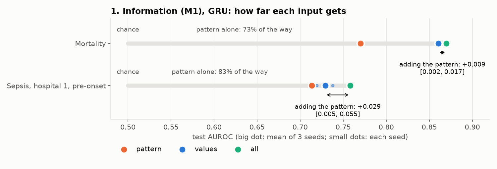
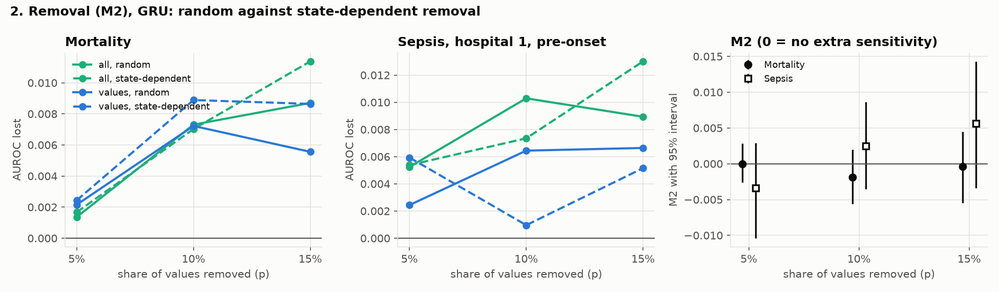
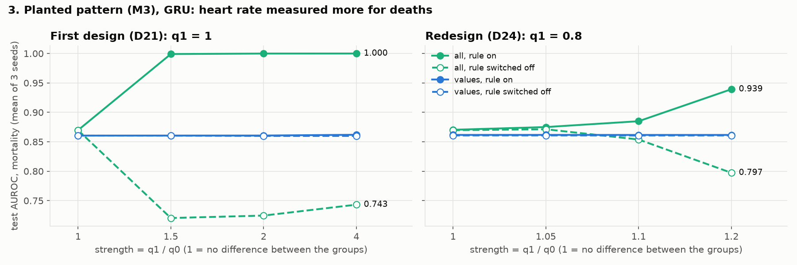
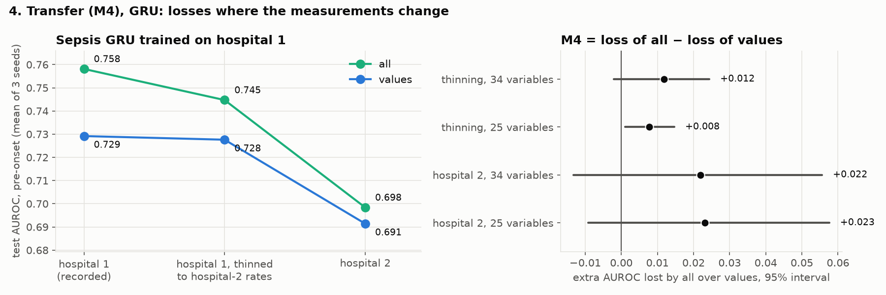

# Week 2 handoff (owners: Luca, Matteo; 16–22 Nov) → week 3 (Giulio)

*Kind: log (the handoff from week 2 to week 3; frozen after the handoff call). Map of all docs: [docs/README.md](../README.md).*

**What week 2 found, one figure per finding: [section 2](#2-what-the-gru-found-with-figures).**
In one line: the measurement pattern is informative but mostly repeats the values; the GRU is
not more sensitive to state-dependent removal than to random removal; it picks up a planted
pattern in proportion to its strength and then suffers when that pattern changes; with the
pattern it loses more at hospital 2 (interval includes 0).

Read this first, then `docs/current/conclusions.md` (what we found and the questions for Sarah).
Luca's handoff of 17 Nov, with every check of phase 0, is kept as
`docs/log/handoff_week_02_phase0_luca.md`; its findings, updated, are in `docs/current/conclusions.md`,
its decisions in `docs/log/decisions.md`. Which document is static, living or a log:
`docs/README.md`.

## 1. In short

1. The protocol is frozen (`protocol-v1`, D15–D24): data, splits, tuning, training,
   evaluation and the four measures M1–M4 are the same for every model and every person.
2. **Every GRU run of the study is done** (both tasks, on a laptop CPU): tuning, 9 runs per
   task, the planted pattern (2 × 24 runs), the 25-variable sepsis runs (6), removal, thinning and
   hospital 2. Numbers: `results/runs.csv`, `results/measures.csv`, read in `docs/current/conclusions.md`.
3. **Your job:** implement GRU-D and ODE-RNN with the three input variants (plan section 4),
   make `tests/test_models.py` pass for them, then run exactly the commands of section 5 below
   with `M=grud` and `M=odernn`. Nothing else changes.
4. The GRU runs fit on a laptop: 104 runs and their evaluation in roughly 7 hours of one
   chain (we ran two at once, which made each 2–3x slower). Measure one epoch of your
   models before setting up the cluster; you may not need it.
5. Open for you: Q5 (which implementations to port); record your choice as D25 and D26.

## 2. What the GRU found, with figures

All numbers are test AUROC, means of 3 seeds. Sepsis models are trained on hospital 1 and
scored on the hours before onset. Intervals are 95% paired patient bootstraps. Every number
and its discussion: `docs/current/conclusions.md`.

The figures come from `python scripts/plot_findings.py`, which reads only
`results/runs.csv` and `results/measures.csv`. Once your rows are in, run it with
`--model grud` and `--model odernn` to get the same four figures for your models.

### 2.1 Information (M1): the pattern carries a lot, but mostly what the values already say



- The `pattern` GRU gets 73% (mortality) and 83% (sepsis) of the way from chance to the full
  model (the share S).
- Added to the values, the pattern gains little: Δmask +0.009 [0.002, 0.017] for mortality,
  +0.029 [0.005, 0.055] for sepsis.
- Δmask is a lower bound, because forward-filled values leak timing. For GRU-D the `values`
  variant is a plain GRU; say so wherever it is reported.

### 2.2 Removal (M2): no extra sensitivity to state-dependent removal



- Left and middle: AUROC lost when a share p of the values is removed, at random (solid) or
  from busy hours (state-dependent, dashed). Every loss is at most 0.013.
- Right: M2 = (state-dependent − random) for `all`, minus the same for `values`. Every
  interval covers 0.
- State-dependent removal even hurts less for sepsis at p = 10%: the extra tests of a busy
  hour mostly repeat what was just measured.
- Caveat: only 17–24% of the values are such extras, so p stops at 15% (question 2 for Sarah).

### 2.3 Planted pattern (M3): found in proportion to its strength



- Mortality, heart rate kept with probability q1 for deaths and q1/strength for survivors.
  "Switched off": the same test patients, every patient keeps heart rate at one rate.
- Left, D21 (q1 = 1): a missing heart-rate value meant "survivor", so `all` reached 0.999 at
  every strength and there was nothing left to measure. GRU only.
- Right, D24 (q1 = 0.8), the design you run: `all` gains +0.005, +0.015 and +0.069 at strength
  1.05, 1.1 and 1.2. Switched off at 1.2 it falls to 0.797, below `values` (0.862).
- `values` stays flat: it never uses the planted pattern.

### 2.4 Transfer (M4): with the pattern, more loss at hospital 2



- Left: the sepsis GRU on hospital 1, on the same hospital-1 test patients thinned to
  hospital-2 measurement rates, and on hospital 2. `all` drops 0.060, `values` 0.038.
- Right: M4 = the extra loss of `all` over `values`. At hospital 2 +0.022 [−0.013, 0.056]
  (about 120 septic test patients there, so the interval includes 0); under thinning +0.012
  [−0.002, 0.024]. On the 25 variables both hospitals measure alike, the picture is the same.
- Thinning removes values as well as changing the pattern, hence the comparison with
  `values`. RQ3 is an exploratory association.

Your runs answer whether GRU-D and ODE-RNN, which use the gaps directly, behave the same.

## 3. Where the repository stands

| Item | State |
| --- | --- |
| PR #1 `luca_branchmann` | phase 0 (cut at hour 59, matched removal, paired bootstrap, planted-pattern code). Reviewed by Matteo, no blocker. **Merged 20 Nov.** |
| PR #5 `matteo/protocol-v1` | on top of PR #1: the protocol (D20–D23), all GRU runs and their tables, this handoff, `docs/current/conclusions.md`. **Merged 20 Nov.** |
| Tag `protocol-v1` | the commit that froze the protocol, including the planted-pattern redesign (D24). The tuned GRU configurations were added after it by `scripts/pick_config.py`, as the protocol says |
| Your branch | `giulio/grud-odernn` from `main` (both PRs are in it) |
| Data | not in git: `bash scripts/download_data.sh`, then `python scripts/prepare_data.py physionet2019 physionet2012` (about 30 min) |
| GRU predictions | in `outputs/` on Matteo's laptop (patient-level, never in git). Only needed if someone wants a paired test between models; ask Matteo |

## 4. The protocol in one table

Do not change any of this without a new D-number agreed by the team; a change means the GRU
runs have to be redone.

| What | Rule | Where |
| --- | --- | --- |
| Data | sepsis records cut at ICU hour 59 (D15); sepsis trained on hospital 1 (D11), scored on both hospitals; mortality first 48 h | `configs/data/` |
| Splits | committed patient splits `seed0` (D8) | `splits/` |
| Inputs | `values` / `pattern` / `all` as in plan section 4; `pattern` gets no static covariates (D7) | `models/inputs.py` and your model |
| Training | Adam, batch 64, up to 30 epochs, early stopping on validation AUROC (patience 5), gradient clipping 1.0, no class weights | `configs/experiment/<task>_<model>.yaml` |
| Tuning | 8 configurations: hidden {64, 128} × lr {1e-3, 3e-4} × weight decay {0, 1e-5}, seed 0, `all`, best validation AUROC; test sets not scored; the choice is written as a `tuned` block and used for every variant and seed (D20) | `slurm/submit_tuning.sh`, `scripts/pick_config.py` |
| Seeds | 0, 1, 2 for every cell | run scripts |
| Planted pattern (E5) | mortality, HR kept with q1 = 0.8 for deaths, q0 = 0.8/strength for survivors, strength {1, 1.05, 1.1, 1.2}, `all` and `values` (D24; the first design, D21, saturated and is GRU only) | `slurm/submit_planted.sh` |
| 25 variables | sepsis `values` and `all` on the 25 variables both hospitals measure at a comparable rate (D22) | `configs/experiment/sepsis_comparable_<model>.yaml` |
| Evaluation | removal p ∈ {0.05, 0.10, 0.15} with removal seed 0, random matched per variable (D16, D17); thinning seeds 0–2 (D14); rule off for E5. Every model sees the same perturbed test sets (D23) | `scripts/evaluate_runs.py` |
| Measures | M1–M4 as means over seeds, 95% interval from a paired patient bootstrap (D19, D23); sepsis: pre-onset hours are the headline | `scripts/measures.py` |
| Traceability | every run saves its config with the git commit; a commit ending in `-dirty` is not a result | `outputs/<run>/config.yaml` |

## 5. Suggestions for week 3

### 5.1 Set up (Monday)

```bash
git fetch && git checkout main && git pull      # main has PR #1 and PR #5
git checkout -b giulio/grud-odernn
bash scripts/ledger.sh                          # what the others are doing
pip install -e ".[dev]"                         # README, "Quick start"
bash scripts/download_data.sh && python scripts/prepare_data.py physionet2019 physionet2012
pytest                                          # 10 xfail = the two model stubs, expected
python scripts/check_data.py physionet2019      # hour-59 table: docs/current/conclusions.md, section 2
```

### 5.2 Implement the two models

`src/missingness/models/grud.py` and `odernn.py` are stubs with pointers to the original code
(Q5: pick one implementation each, record it as D25 and D26). The interface is fixed:
`__init__(n_vars, n_static, inputs, **cfg)` and `forward(batch) -> logits (B, T)`, one logit
per hour, causal. The batch is built in `data/dataset.py::collate`: `x` (forward-filled,
z-scored, 0 = training mean before the first measurement), `m` (mask), `delta` (hours since
the variable was last measured), `static`, `lengths`.

| Model | `values` | `pattern` | `all` |
| --- | --- | --- | --- |
| GRU-D | plain GRU on `x` (say so wherever it is reported) | decay driven by the gaps, values set to a constant | the original model |
| ODE-RNN | update every hour with forward-filled `x`, no mask | update with `m` only | update with `x` and `m` (the original model) |

Done when:

1. `tests/test_models.py` passes for your model: remove its name from `STUBS` at the top of
   the file. The test checks shape, causality (the logit at hour t ignores everything after
   t) and that `values` ignores the mask and `pattern` ignores the values.
2. Each model has under 1 M parameters (plan section 4).
3. `python -m missingness.train configs/experiment/smoke.yaml model.name=grud` runs (and
   `odernn`), `ruff check . && ruff format --check . && pytest` pass.
4. One epoch on real data is timed; note it in `docs/current/experiments.md` (compute budget).

### 5.3 Run them, same commands as the GRU

Run from a committed state, otherwise each run records a `-dirty` commit. Week 2 did this from
a second worktree, so the docs could keep changing in the main checkout:

```bash
git worktree add --detach ../missingness_physionet_runs HEAD
cd ../missingness_physionet_runs
MAIN=../missingness_physionet
source $MAIN/.venv/bin/activate
export PYTHONPATH="$PWD/src" MISSINGNESS_DATA_DIR="$MAIN/data" MISSINGNESS_OUTPUT_DIR="$MAIN/outputs"
export PYTHONUNBUFFERED=1 OMP_NUM_THREADS=6     # half the cores per chain if you run two chains
# after each new commit in the main checkout: git checkout --detach <commit>
```

Then, for `M=grud` and then `M=odernn` (on the cluster drop `LOCAL=1`, see 5.4):

```bash
# mortality first (gate: `all` test AUROC in the published range, about 0.82-0.86)
LOCAL=1 bash slurm/submit_tuning.sh mortality $M            # 8 runs, test sets untouched
python scripts/pick_config.py mortality $M --write          # in the MAIN checkout, then:
git add configs/experiment/mortality_$M.yaml && git commit -m "Freeze the tuned mortality $M configuration"
#   (move the run worktree to that commit)
MODELS=$M LOCAL=1 bash slurm/submit_ablations.sh mortality  # 9 runs
MODELS=$M LOCAL=1 bash slurm/submit_planted.sh              # 24 runs (E5, D24 design)

# sepsis, trained on hospital 1, every run scored on both hospitals
LOCAL=1 bash slurm/submit_tuning.sh sepsis $M               # 8 runs
python scripts/pick_config.py sepsis $M --write             # writes sepsis_$M and sepsis_comparable_$M
git add configs/experiment/sepsis*_$M.yaml && git commit -m "Freeze the tuned sepsis $M configuration"
MODELS=$M LOCAL=1 bash slurm/submit_ablations.sh sepsis                              # 9 runs
MODELS=$M INPUTS="values all" LOCAL=1 bash slurm/submit_ablations.sh sepsis_comparable  # 6 runs

# standard evaluation, tables (in the main checkout)
python scripts/evaluate_runs.py --runs "*_${M}_*"           # removal, thinning, rule off
python scripts/collect_results.py --models grud odernn      # -> results/runs.csv, GRU rows kept
python scripts/measures.py --models grud odernn             # -> results/measures.csv, GRU rows kept
```

References from the GRU (test AUROC of `all`): mortality 0.870; sepsis, hospital 1, pre-onset
0.758. A model far below these points to a bug before it points to a result.

64 runs per model, 128 in all. Every script skips runs and evaluations that already exist,
so a chain can be restarted after a crash. Commit `results/runs.csv` and
`results/measures.csv` (aggregate tables only), add your line to `docs/log/work_ledger.md`, write
`docs/log/handoff_week_03.md` on Sunday.

### 5.4 Laptop or cluster

The GRU needed no cluster: a sepsis epoch took 11 s alone on 14 CPU cores (about 20 s with a
second chain running), a mortality epoch about 4 s. Records are short (at most 60 hourly
steps for sepsis, 48 for mortality), so a GRU-D or ODE-RNN with a Python loop over the hours
may still fit on a laptop. If one sepsis epoch takes more than about a minute, use the
cluster: fix the `#SBATCH` lines in `slurm/train.sbatch` and fill in `docs/current/cluster.md`. Run
`evaluate_runs.py` where the `outputs/` folder is, and bring back only the two CSV files.

## 6. Pitfalls we already hit

- **"Mean of empty slice" warning** when loading sepsis: EtCO2 is never measured at hospital 1,
  so its training mean is undefined and set to 0. Harmless.
- **Never pick a configuration or an epoch by looking at test numbers.** Tuning runs do not
  even score the test sets; `pick_config.py` reads validation AUROC only.
- **GRU-D `values` is a plain GRU.** Still run it with the GRU-D tuned configuration, so every
  model has the full matrix; the report must say it is a GRU.
- **ODE-RNN on an hourly grid:** the step between two rows is always 1 hour; `delta` is the
  time since a *variable* was last measured, not the step. Keep the fixed-step solver of
  `configs/model/odernn.yaml` (`euler`) unless D26 says otherwise; `dopri5` is much slower.
- **Mortality reads one logit per stay**, at the last observed hour (`label_mask`); the model
  still outputs one logit per hour.
- **`measures.py` stops with "prediction files of one measure do not have the same rows"** if
  two runs were scored on different data (for example with a changed data config). Rerun the
  odd one; do not loosen the check.
- **`--skip-done`** skips a run whose `metrics.json` exists. To redo a run, delete its folder.
- **Two chains in parallel** on one laptop slow each other down by about 2–3x; set
  `OMP_NUM_THREADS` so the two together do not exceed the cores.
- **Without `--models`**, `collect_results.py` and `measures.py` rewrite the whole table from
  your `outputs/` folder and drop the GRU rows. Always pass `--models grud odernn`.
- **`measures.py` takes about 20 minutes per model** on a laptop (the bootstrap runs over every
  sepsis hour). Run it once, when all runs of a model are evaluated.
- **The sepsis `pattern` variant runs to the 30-epoch cap** (the GRU's did, at 28–30 epochs).
  That is the protocol; do not raise the cap for one model.

## 7. Open items

| # | Item | Who |
| --- | --- | --- |
| Q5 | GRU-D and ODE-RNN implementations to port → D25, D26 | Giulio |
| – | Questions for Sarah (`docs/current/conclusions.md`, section 7): send before the next meeting | Matteo |
| – | Owner of week 4 (measures for all three models, figures, results note) | team |
| – | Cluster login and `docs/current/cluster.md`, only if the laptop is too slow | Giulio |

## 8. How to rerun everything of week 2

```bash
python scripts/check_data.py physionet2019 physionet2012   # data facts + hour-59 table
python scripts/run_baselines.py                             # baselines + SOFA check, ~30 min
python scripts/build_thinned_sets.py --seeds 0 1 2          # thinned hospital-1 test sets
python scripts/removal_shares.py                            # how much removal can remove
# GRU: section 5.3 with M=gru, plus the plan's check of tuning on `values`:
INPUTS=values LOCAL=1 bash slurm/submit_tuning.sh <task> gru
python scripts/pick_config.py <task> gru --inputs values
# and the first, saturated planted design (D21), GRU only:
Q1=1.0 STRENGTHS="1 1.5 2 4" MODELS=gru LOCAL=1 bash slurm/submit_planted.sh
python scripts/evaluate_runs.py && python scripts/collect_results.py && python scripts/measures.py
python scripts/plot_findings.py                             # the figures of section 2
```
